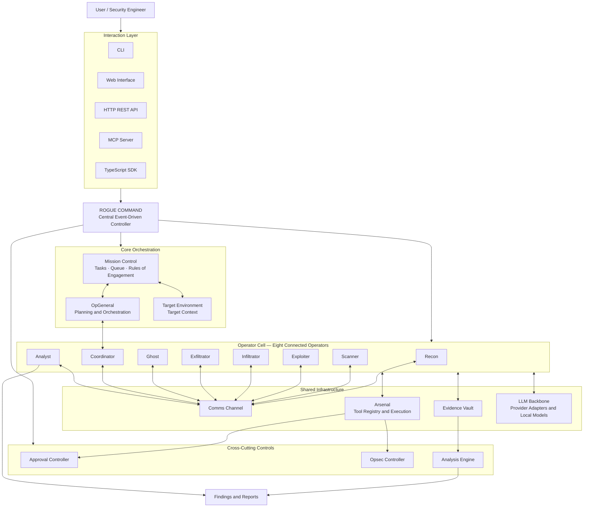

# ROGUE — Multi-Agent Security Assessment Harness

## 1. Project Objective

ROGUE is a modular, LLM-driven security assessment harness designed around a central orchestration engine, eight specialist operators, a shared tool execution layer, and centralized evidence management.

The primary objective is to connect all eight operator roles into a coordinated system where individual agents can receive tasks, execute their assigned responsibilities, communicate findings, share relevant context, and contribute to a unified mission.

The original T3MP3ST architectural foundations remain unchanged. ROGUE will focus on making the eight-operator architecture work as a coordinated system.

## 2. High-Level Architecture

## 3. Layer-by-Layer Architecture

### Layer 1 — Interaction Layer

Provides the interfaces through which users interact with ROGUE.

| Component | Responsibility |
|---|---|
| CLI | Terminal-based interaction |
| Web Interface | Browser-based mission interface |
| HTTP API | Programmatic mission management |
| MCP Server | Exposes selected ROGUE capabilities to MCP-compatible agents |
| TypeScript SDK | Allows developers to embed ROGUE |

### Layer 2 — Central Orchestration

**ROGUE Command** is the central composition root and event-driven controller.

It initializes and connects:

- MissionControl
- OperatorCell
- TargetEnvironment
- EvidenceVault
- Arsenal
- LLMBackbone
- OpsecController
- CommsChannel
- AnalysisEngine
- ApprovalController

`OpGeneral` remains the higher-level planning and orchestration component.

### Layer 3 — Eight-Operator System

The eight operator archetypes remain unchanged.

| Operator | Intended responsibility |
|---|---|
| Recon | Asset and environment discovery |
| Scanner | Security assessment and discovery |
| Exploiter | Initial-access research |
| Infiltrator | Post-access assessment |
| Exfiltrator | Data-flow and collection assessment |
| Ghost | Persistence-related assessment |
| Coordinator | Coordination and mission control |
| Analyst | Findings analysis and reporting |

**ROGUE's primary development objective:** Connect all eight operators through a shared coordination system rather than treating them as isolated role definitions.

### Layer 4 — Agent Execution Engine

The central execution abstraction remains `AgentLoop`.

Each operator uses the same fundamental ReAct-style execution cycle:

1. Receive a task and system prompt.
2. Ask the configured LLM to reason about the task.
3. Receive a tool call or response.
4. Pass approved tool requests to Arsenal.
5. Return tool results as observations.
6. Continue until a conclusion or execution limit.

The loop continues to track execution steps, findings, token usage, duration, and iteration limits.

### Layer 5 — LLM Backbone

`LLMBackbone` separates agent logic from model providers.

It provides a common abstraction for hosted and local models and connected coding-agent environments.

### Layer 6 — Arsenal / Tool Execution

Arsenal remains the abstraction between model decisions and external tools.

Responsibilities:

- Tool registration and discovery
- Tool definitions exposed to the LLM
- Built-in tool execution
- External tool adapters
- Execution results and errors
- Scope and approval-related controls

### Layer 7 — Shared State, Communication and Evidence

| Module | Responsibility |
|---|---|
| TargetEnvironment | Stores target context |
| EvidenceVault | Stores findings and supporting evidence |
| CommsChannel | Enables communication between operators |
| OpsecController | Manages OPSEC-related state and controls |
| ApprovalController | Enforces capability approval boundaries |
| AnalysisEngine | Analyzes findings and mission state |
| Reporting | Produces mission reports |

### Layer 8 — Multi-Agent Coordination (ROGUE's Main Development Focus)

This is the main area ROGUE intends to develop beyond the existing architectural foundation.

The eight operators should be connected through:

- **Task coordination:** Assign tasks and track their completion.
- **Shared context:** Make relevant mission information available to operators.
- **Inter-agent communication:** Share findings, observations and task updates.
- **Dependency management:** Track which tasks depend on other tasks.
- **Evidence synchronization:** Maintain a consistent source of mission evidence.
- **Central supervision:** Allow the coordinator to monitor mission progress.
- **Conflict resolution:** Handle duplicate, conflicting or incomplete findings.

The existing Coordinator and OpGeneral concepts provide the architectural starting point for this layer.

## 4. Core Execution Flow

1. User creates a mission.
2. ROGUE Command initializes the mission.
3. MissionControl establishes the task structure and applicable rules.
4. OpGeneral plans and coordinates task assignment.
5. Coordinator manages the operator workflow.
6. Specialist operators execute their assigned tasks using AgentLoop.
7. Arsenal mediates tool execution.
8. CommsChannel distributes relevant observations and updates.
9. EvidenceVault stores findings and supporting evidence.
10. AnalysisEngine processes mission results.
11. Analyst contributes to the final findings and report.
12. ROGUE returns the mission report to the user.

## 5. Development Priorities

| Priority | Development objective |
|---|---|
| P0 | Establish the core harness and single-agent execution |
| P1 | Connect all eight operator instances |
| P2 | Implement shared context and inter-agent communication |
| P3 | Implement task dependencies and coordination |
| P4 | Integrate evidence synchronization and centralized reporting |
| P5 | Test and evaluate complete multi-agent mission workflows |

## 6. Architectural Principle

ROGUE preserves the separation between:

- Central orchestration
- Agent reasoning loops
- LLM provider abstraction
- Tool execution
- Shared state and communication
- Evidence and analysis

The central goal is to evolve this foundation into a coordinated eight-operator harness, with measurable validation of the complete system rather than relying on the existence of individual components.
